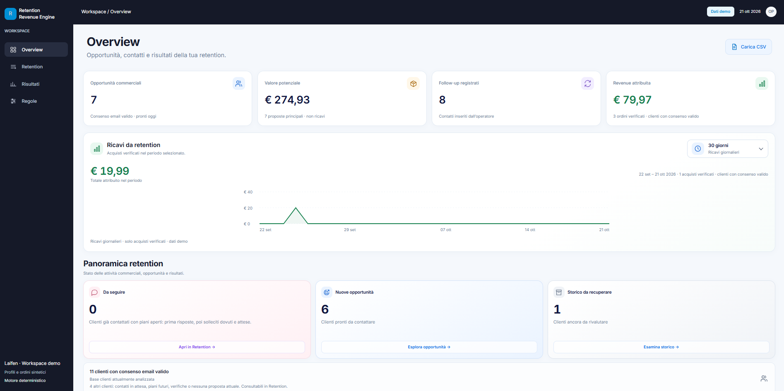
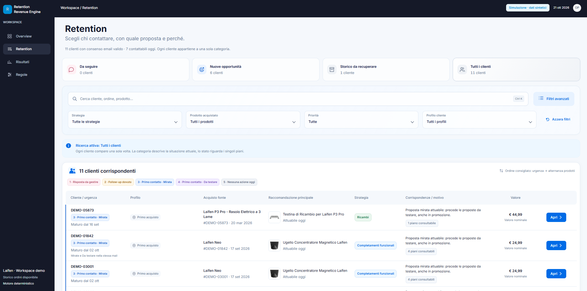
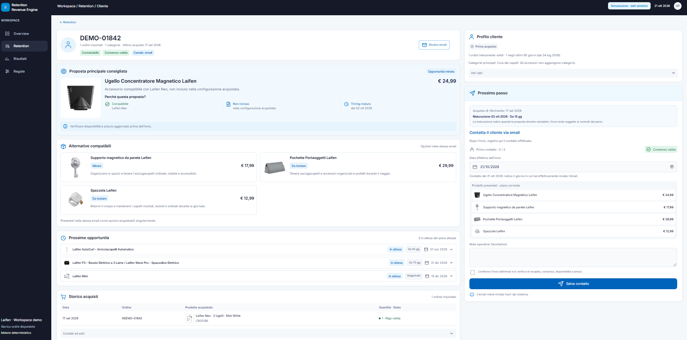

# Dall'analisi dei dati alla progettazione di un sistema CRM

**Retention Revenue Engine** · Prototipo operativo per la retention e-commerce.

**[Apri la demo online](https://retention-revenue-engine-demo.onrender.com)** — accesso libero, senza registrazione, con clienti e ordini sintetici.

## 1. Il punto di partenza: un'opportunità di retention

Il progetto nasce dall'analisi delle performance e-commerce di Laifen, brand di elettronica di consumo specializzato in asciugacapelli, spazzolini elettrici e rasoi.

Analizzando i dati Shopify, ho osservato che gran parte dei clienti effettuava un solo acquisto e che la frequenza dei riacquisti nei mesi successivi risultava contenuta.

Questa osservazione mi ha portato a una domanda commerciale:

**Come possiamo sfruttare lo storico degli acquisti per individuare opportunità di vendita successive al primo ordine?**

L'obiettivo non era semplicemente aumentare il numero di comunicazioni inviate, ma capire quali clienti potessero ricevere proposte pertinenti, sulla base dei prodotti già acquistati.

## 2. L'analisi dei comportamenti d'acquisto

Il primo approccio è stato analizzare lo storico degli ordini Shopify, cercando combinazioni ricorrenti tra primo e successivo acquisto.

Volevo identificare comportamenti sufficientemente frequenti da poter costruire strategie di cross-selling e retention basate su evidenze storiche.

Sono però emersi alcuni limiti:

- Il brand disponeva di uno storico commerciale relativamente breve, circa due anni e 10.000 ordini.
- Molti clienti avevano effettuato un solo acquisto.
- Le combinazioni di riacquisto disponibili non mostravano pattern abbastanza solidi da giustificare regole predittive affidabili.
- I prodotti principali erano beni durevoli, per i quali non è necessariamente ragionevole aspettarsi riacquisti frequenti dello stesso dispositivo.

**Conclusione:** lo storico degli ordini era utile per conoscere i clienti e i prodotti posseduti, ma non offriva evidenze sufficienti per costruire un motore di raccomandazione basato principalmente sui comportamenti di riacquisto.

## 3. Il cambio di approccio: partire dai prodotti

Ho quindi invertito il ragionamento.

Invece di chiedermi soltanto *«Che cosa hanno acquistato successivamente i clienti?»*, ho iniziato a chiedermi:

**«Considerando il prodotto acquistato, quale proposta commerciale potrebbe avere senso per quel cliente?»**

Ho analizzato il catalogo Laifen identificando compatibilità tecniche, accessori non inclusi, prodotti complementari, ricambi e possibili espansioni di categoria.

Da questa analisi sono nate cinque strategie commerciali.

| Strategia | Logica |
|---|---|
| Completamenti funzionali | Accessori compatibili non inclusi o non ancora acquistati |
| Complementi d'uso | Prodotti che possono arricchire l'esperienza d'utilizzo |
| Espansione di categoria | Introduzione a categorie non presenti nello storico acquisti |
| Ricambi | Componenti soggetti a sostituzione periodica |
| Upgrade | Passaggio a modelli successivi o superiori |

Le proposte sono state distinte tra opportunità con una motivazione funzionale specifica e ipotesi commerciali da validare.

Questa distinzione è importante: **la compatibilità di un prodotto può essere verificata tecnicamente, mentre la probabilità che un cliente lo acquisti deve essere dimostrata commercialmente.**

## 4. Dalle strategie alle regole operative

Una volta definite le strategie, le ho trasformate in regole commerciali deterministiche.

Ogni regola identifica:

- Il prodotto o la categoria di partenza.
- Il prodotto potenzialmente proponibile.
- Le condizioni di compatibilità e le esclusioni.
- La soglia temporale minima di attivazione.
- Le condizioni relative a consenso, acquisti e contatti precedenti.
- La motivazione della proposta.

### Esempio: percorso di retention per gli asciugacapelli

Il sistema prevede differenti opportunità nel tempo.

| Fase | Soglia / finestra | Proposta |
|---|---|---|
| Completamento | Da 15 giorni | Accessori compatibili e complementi |
| Cross-selling | Da 45 giorni | Laifen AutoCurl |
| Espansione | Da 75 giorni | Spazzolino Wave Pro o rasoio P3/P3 Pro |
| Stagionale | Finestre definite | Laifen Mini per viaggi e mobilità |

Le soglie rappresentano ipotesi commerciali iniziali, non intervalli di acquisto statisticamente dimostrati. Non corrispondono a invii automatici. Per i nuovi ordini decorrono dall’acquisto reale; per gli ordini vecchi da recuperare, AutoCurl ed espansione maturano rispettivamente dopo 45 e 75 giorni dal primo contatto accessori registrato. Ogni fase resta soggetta alla conclusione delle precedenti applicabili e ai limiti di contatto.

Per ciascun cliente il sistema verifica le condizioni applicabili, tiene conto delle attività già registrate e rivaluta le opportunità quando arrivano nuovi ordini.

Il risultato non è un calendario di email generiche, ma un insieme di proposte contestualizzate e motivate.

## 5. Dal modello commerciale al software

Definite le regole, rimaneva un problema operativo: come renderle utilizzabili quotidianamente senza analizzare manualmente ogni cliente?

La segmentazione standard di Shopify poteva coprire parte dei criteri, ma non offriva da sola il flusso operativo integrato che volevo ottenere.

Ho quindi progettato **Retention Revenue Engine**, un'applicazione che trasforma gli ordini Shopify in opportunità commerciali gestibili.

Il sistema permette di:

- Analizzare i clienti secondo le regole commerciali definite.
- Individuare opportunità applicabili e motivazioni delle proposte.
- Organizzare e filtrare i clienti da contattare.
- Consultare lo storico degli acquisti e dei contatti.
- Registrare attività, risposte ed esiti commerciali.
- Distinguere il valore nominale delle proposte dai ricavi associati ad acquisti verificati.

Le decisioni commerciali sono gestite da un motore deterministico nel backend. La dashboard rende le informazioni comprensibili e utilizzabili dagli operatori.

L'obiettivo non è sostituire il giudizio commerciale, ma ridurre il lavoro manuale necessario per individuare, valutare e gestire le opportunità.

### Overview: leggere la situazione

Opportunità contattabili, valore nominale, attività registrate e ricavi verificati, con accesso ai gruppi Da seguire, Nuove opportunità e Storico da recuperare.



### Retention: scegliere chi contattare

Ricerca e filtri permettono di consultare le opportunità ordinate per urgenza, con proposta principale e motivazione della priorità.



### Scheda cliente: dalla proposta all’azione

Il cliente sintetico DEMO-01842 ha acquistato un Neo a due ugelli. La scheda propone il concentratore compatibile non incluso, mostra alternative e calendario e permette di registrare il contatto effettuato fuori dal sistema.



*Tutti gli screenshot utilizzano dati sintetici; i valori mostrati non rappresentano risultati aziendali reali.*

## 6. Validazione e sviluppi

Il progetto è attualmente un prototipo operativo con demo interattiva basata su dati sintetici.

La logica di compatibilità e i flussi applicativi possono essere verificati, ma l'efficacia delle strategie commerciali non è ancora stata dimostrata su risultati reali.

La fase successiva consiste nel raccogliere e analizzare gli esiti dei contatti per comprendere:

- Quali strategie generano maggiore interesse.
- Quali proposte si traducono in acquisti.
- Quali intervalli temporali risultano più efficaci.
- Quali regole richiedono modifiche o devono essere eliminate.
- Dopo che il sistema e la logica generale sarà validata manualmente, si potrà procedere ad automatizzare l'invio delle comunicazioni ai clienti

La valutazione dovrà distinguere le vendite associate ai contatti da quelle effettivamente incrementali.

**Il progetto segue quindi un processo iterativo: osservazione del problema, analisi dei dati, formulazione di ipotesi commerciali, sviluppo della soluzione e successiva validazione attraverso gli esiti reali.**

---

## Avvia la demo in locale

Richiede **Python 3.12**. Dalla cartella del progetto:

```sh
python -m pip install -r requirements.txt
python -m src.web --demo --as-of 2026-10-21
```

Apri **http://localhost:8000**.

**La demo utilizza esclusivamente clienti, ordini e recapiti sintetici.** Puoi esplorare le sezioni, filtrare i clienti e registrare contatti ed esiti. Le Regole sono le stesse della modalità operativa.

- La data di valutazione è fissata per rendere riproducibile la dimostrazione.
- Le modifiche restano nel database temporaneo e si azzerano al riavvio.
- Il caricamento CSV è disabilitato nella demo.
- Per avviare la demo, lascia non configurate `DATABASE_URL` e `DATABASE_PATH`.

Per pubblicarla senza login su un **servizio Render separato**, usa `pip install -r requirements.txt` come build command e `python -m src.web --demo --as-of 2026-10-21` come start command. Non configurare credenziali o database operativi nel servizio demo.

## Tecnologie e scelte progettuali

| Livello | Stack |
| --- | --- |
| **Backend** | Python, server HTTP e motore deterministico di valutazione e coordinamento. |
| **Frontend** | HTML, CSS e JavaScript senza framework; layout responsive e navigazione interna senza ricaricare il documento. |
| **Persistenza** | SQLite in locale e PostgreSQL tramite `psycopg` per il database remoto. |
| **Configurazione commerciale** | Catalogo, regole e promozioni in JSON; idoneità e calcoli nel backend. |
| **Verifiche** | `unittest` per il backend e test delle interazioni con Node.js, usando dati sintetici. |

## Ambito e limiti

L’obiettivo è aumentare il riacquisto attraverso proposte pertinenti e una gestione ordinata dei contatti; non sono dichiarati incrementi di conversione già dimostrati.

- **Le email vengono inviate fuori dalla dashboard.** Il sistema registra il contatto effettuato.
- Gli ordini arrivano da export CSV; non c’è sincronizzazione automatica con Shopify o newsletter.
- Il **valore potenziale è nominale**, non una previsione di ricavi o una probabilità di acquisto.
- I ricavi attribuiti richiedono una verifica registrata dall’operatore; non misurano da soli un effetto causale.
- La qualità delle proposte dipende da completezza dello storico, regole approvate e registrazione degli esiti.

Export, database e segreti operativi restano esclusi da Git tramite `.gitignore`. L’installazione remota con dati reali richiede autenticazione; l’accesso pubblico senza login riguarda la sola demo sintetica.

## Documentazione

- [Prodotto e decisioni](project-docs/PRODUCT.md)
- [Architettura e responsabilità del codice](project-docs/ARCHITECTURE.md)
- [Audit funzionale](project-docs/audit/AUDIT_DASHBOARD.md)
- [Regole del repository](AGENTS.md)

## Approfondimenti tecnici

<details>
<summary>Importazione ordini, attivazione e diagnostica CLI</summary>

### Importazione e strumenti da terminale

Python 3.12; `tzdata` è necessario su Windows per convertire i timestamp Shopify in Europe/Rome.

```powershell
python -m pip install -r requirements.txt
```

Su questo PC l'attività di Windows `RetentionRevenueEngine-SanitizeLocalData` avvia
automaticamente la sorveglianza all'accesso dell'utente, senza aprire un terminale.
Per controllare che sia in esecuzione e leggere gli esiti:

```powershell
Get-ScheduledTask -TaskName "RetentionRevenueEngine-SanitizeLocalData" | Select-Object TaskName,State
Get-Content "local-data/sanitizer.log" -Tail 20
```

Metti gli export Shopify completi direttamente in `local-data/`, dopo che il download
è terminato. Il processo locale attende che ogni CSV sia
stabile, verifica una copia con le sole undici colonne necessarie e sostituisce il file
originale nella stessa cartella. Mantiene l'email per collegare gli ordini e consentire
il contatto; elimina le colonne con nome cliente, indirizzo e telefono. Se la pulizia
fallisce, il file originale resta intatto e l'errore compare in `sanitizer.log`. Dopo
la pulizia, il processo importa i CSV nuovi in `local-data/retention.sqlite3`, senza
inviare dati a Codex. L'attività parte al
login e resta attiva per la sessione Windows; se viene fermata, usa
`Start-ScheduledTask -TaskName "RetentionRevenueEngine-SanitizeLocalData"`.
Se il progetto viene spostato o Python viene reinstallato, l'attività va riconfigurata.
Su un altro PC, il comando manuale è `python -m src.customer_profiles sync --watch`;
per una sola elaborazione, ometti `--watch`.
L'importatore rifiuta i CSV con colonne aggiuntive prima di leggere le righe: verifica
che la pulizia sia riuscita prima di chiedere a Codex di analizzare i dati.

Per verificare un export ordini senza mostrare dati cliente:

```powershell
python -m src.shopify_orders "local-data/orders_export.csv"
```

L'import restituisce fatti d'ordine e righe con SKU, EAN mappato, quantità, data e validità conservativa, più un collegamento separato ID ordine → email quando presente. Il backend salva profili e ordini in `local-data/retention.sqlite3`; l'email resta in una tabella separata. `Accepts Marketing` concorde sugli ordini del profilo determina il consenso email; i casi incerti sono separati per revisione.

Per importare più export nella stessa base dati, applicandoli nell'ordine indicato:

```powershell
python -m src.customer_profiles import "local-data/orders_1.csv" "local-data/orders_2.csv"
```

Se un ordine compare in più file, l'ultima versione sostituisce la precedente. L'import ripetuto non duplica ordini e non cancella gli eventi registrati. Il database registra nome e hash dei CSV importati per controllare la sequenza applicata.

Quando gli export disponibili sono stati importati, attivare il programma:

```powershell
python -m src.customer_profiles activate --date AAAA-MM-GG
```

Sostituire `AAAA-MM-GG` con la data di attivazione scelta per l’installazione; non eseguire il comando a ogni avvio. La data è il punto zero dei contatti gestiti da questo sistema. Prima dell'attivazione nessun profilo appare nella lista lavorabile. Lo storico è considerato completo **rispetto ai soli CSV disponibili**; nuovi file ampliano i profili e cambiano le valutazioni. Un acquisto precedente assente dai file non può essere escluso con certezza.

Per ottenere la lista giornaliera dei piani lavorabili e dei casi da verificare:

```powershell
python -m src.customer_profiles evaluate --as-of 2026-09-29
```

Senza `--as-of` viene usata la data corrente Europe/Rome. La lista contiene ID locali e piani, non email. Un'attività pianificata può eseguire il comando ogni giorno. Gli eventi di contatto e risposta si registrano con `python -m src.customer_profiles event --customer CUST_000001 --json local-data/event.json`, usando il formato documentato in `ARCHITECTURE.md`.

Per attribuire una vendita verificata in Shopify, lo stesso comando accetta un evento `verified_purchase` con ID ordine Shopify, SKU, data acquisto, importo effettivamente pagato in centesimi, `contact_event_id`, `plan_key` e `verified_in_shopify: true`. Una modifica dell'importo usa `revenue_correction` con riferimento all'evento originale e motivazione; l'ordine non viene contato due volte. Il totale cumulativo si legge con:

```powershell
python -m src.customer_profiles revenue --as-of 2026-10-01
```

L'importo è restituito in centesimi di euro. La verifica Shopify è responsabilità dell'operatore; il programma non controlla Shopify direttamente e non deduce revenue dai prezzi di catalogo.

Per il riepilogo di un singolo ordine destinato alla dashboard:

```powershell
python -m src.customer_profiles explain-order --customer CUST_000001 --order ORDINE_001 --as-of 2026-10-01
```

Il JSON non contiene email. Mostra l'ordine, il consenso, il piano corrente con proposta principale e alternative, i piani in attesa, le esclusioni attribuibili all'ordine e i motivi prodotti dal motore. Indica esplicitamente che la probabilità di acquisto non è stimata e che lo storico riguarda i soli ordini importati. I profili da verificare non espongono piani lavorabili.

Valutazione di un file cliente nel formato descritto in `ARCHITECTURE.md`:

```powershell
python src/engine.py local-data/customer.json --as-of 2026-09-23 --portfolio
```

Il comando con `--portfolio` restituisce un piano di contatto primario, gli altri piani in coda e applica almeno 15 giorni tra contatti di piani diversi. Opportunità compatibili dello stesso ordine possono comparire insieme come proposta primaria e suggerimenti secondari.

Il portafoglio legge anche `src/promotions.json`: per la data `--as-of` evidenzia le varianti idonee con campagna pianificata, prezzo e finestra di validità. La campagna precede la priorità ordinaria solo fra opportunità già valide. L'operatore deve confermare che la promozione pianificata sia realmente attiva prima del contatto; il motore non verifica lo store in tempo reale.

Per vedere il percorso operatore con proposte, date e motivazioni:

```powershell
python src/engine.py local-data/customer.json --as-of 2026-09-23 --operator-view
```

Ogni contatto richiede `contact_channel` e consenso `subscribed` in `marketing_consent` per quel canale. Lo stato va aggiornato prima del contatto. Consenso mancante, sconosciuto o revocato blocca anche i ricambi. Gli esempi di snapshot e gli esiti prodotto/piano sono descritti in `ARCHITECTURE.md`.

Per diagnosticare l'esito grezzo della sola regola del concentratore:

```powershell
python src/engine.py local-data/customer.json --as-of 2026-09-23
```

Per valutare la regola SE Lite sullo stesso formato di input:

```powershell
python src/engine.py local-data/customer.json --as-of 2026-09-23 --rule se_lite_diffuser_completion
```

Per valutare la regola del supporto Mini:

```powershell
python src/engine.py local-data/customer.json --as-of 2026-09-23 --rule mini_wall_mount_completion
```

Per valutare il Mini come secondo phon da viaggio nelle finestre annuali 15 maggio–5 settembre e 15 dicembre–15 gennaio:

```powershell
python src/engine.py local-data/customer.json --as-of 2026-12-15 --rule mini_travel_cross_sell
```

Per valutare l'espansione da asciugacapelli a Wave Pro:

```powershell
python src/engine.py local-data/customer.json --as-of 2026-09-23 --rule hair_dryer_to_wave_pro_category_expansion
```

Per diagnosticare la componente rasoi del piano di espansione, separato dalla mail AutoCurl:

```powershell
python src/engine.py local-data/customer.json --as-of 2026-09-23 --rule hair_dryer_to_shavers_category_expansion
```

Per valutare l'espansione da Wave o Wave Pro a Neo:

```powershell
python src/engine.py local-data/customer.json --as-of 2026-09-23 --rule toothbrush_to_neo_category_expansion
```

Per valutare la regola del supporto Neo:

```powershell
python src/engine.py local-data/customer.json --as-of 2026-09-23 --rule neo_wall_mount_completion
```

Per valutare la proposta della spazzola:

```powershell
python src/engine.py local-data/customer.json --as-of 2026-09-23 --rule brush_complement
```

Per valutare la proposta AutoCurl:

```powershell
python src/engine.py local-data/customer.json --as-of 2026-09-23 --rule autocurl_cross_sell
```

Per valutare la proposta della pochette:

```powershell
python src/engine.py local-data/customer.json --as-of 2026-09-23 --rule storage_pouch_cross_sell
```

Per valutare la proposta dell'astuccio P3/P3 Pro:

```powershell
python src/engine.py local-data/customer.json --as-of 2026-09-23 --rule p3_travel_case_cross_sell
```

Per valutare il ciclo di ricambio della testina P3 Pro:

```powershell
python src/engine.py local-data/customer.json --as-of 2026-09-23 --rule p3_pro_head_replenishment
```

Per valutare il ciclo di ricambio delle testine Wave Pro:

```powershell
python src/engine.py local-data/customer.json --as-of 2026-09-23 --rule wave_pro_heads_replenishment
```

Per valutare la sostituzione del precedente Wave con Wave Pro:

```powershell
python src/engine.py local-data/customer.json --as-of 2026-09-23 --rule wave_legacy_to_wave_pro_replacement
```

I comandi leggono il file e stampano la decisione in JSON; non registrano follow-up e non inviano contatti. Il file cliente va fornito separatamente e non è l'export CSV Shopify grezzo.

</details>

<details>
<summary>Dashboard operativa e dati locali</summary>

### Dati locali

Git esclude `local-data/`; l'import usa soltanto i CSV ridotti dallo script locale.

### Dashboard operativa

Riferimento di design: [Customer Retention engine — Figma](https://www.figma.com/design/J7V1NPhw8pEtPaBoq542Lh/Customer-Retention-engine.-design?node-id=0-1).

Avvio dalla radice del repository, con il database degli ordini importati e la data corrente Europe/Rome:

```powershell
python -m src.web
```

Apri http://127.0.0.1:8000. KPI e proposte provengono da `local-data/retention.sqlite3`. I ricavi restano a zero finché non vengono registrati acquisti verificati, senza dedurli dallo storico ordini.

Per scegliere un altro database locale:

```powershell
python -m src.web --database local-data/retention.sqlite3
```

La modalità sintetica separata si avvia con:

```powershell
python -m src.web --demo
```

La demo riproduce il riferimento Figma al 5 ottobre 2026 senza caricare dati reali.

L'interfaccia vive in `frontend/overview.html`, `frontend/overview.css` e `frontend/overview.js`; `src/web.py` serve la pagina e richiama gli aggregati di `src/customer_profiles.py`. Non servono Node o dipendenze frontend. Per impostazione predefinita il server ascolta soltanto su questo PC. Il pulsante Carica CSV usa la pulizia e l'import esistenti; in demo mostra soltanto le istruzioni. Gli upload sono salvati nella sottocartella `uploads` accanto al database. L'attivazione dello storico resta il comando backend `activate`.

Il grafico offre 30/90 giorni e 6/12 mesi, tooltip e aggiornamento ogni minuto mentre la pagina è visibile. I KPI sono cumulativi o riferiti alla valutazione corrente; il selettore modifica soltanto il grafico. Apri mostra la scheda cliente condivisa, con recapito email su richiesta, tutti gli acquisti disponibili, proposta corrente, logica e prossime opportunità, contatti ed esiti.

Sotto ai ricavi, tre riquadri riepilogano Da seguire, Nuove opportunità e Storico da recuperare. Da seguire comprende clienti già contattati con piani aperti: risposte, solleciti dovuti e attese. I primi contatti pronti passano nello storico da 30 giorni dopo la maturazione del piano; non vengono modificate le date reali o le regole delle proposte. Conteggi e filtro contestuale `activity` provengono dal backend. La base con consenso valido include anche i clienti fuori dai gruppi, indicati separatamente. I pulsanti aprono Retention con un chip rimovibile, combinabile con i filtri già presenti.

La sezione http://127.0.0.1:8000/retention offre schede Da seguire, Nuove opportunità, Storico da recuperare e Tutti i clienti, con ricerca, filtri e paginazione. Legge gli stessi ordini ed eventi dell'Overview. Struttura e comportamento vivono in `frontend/retention.html`, `frontend/retention.css`, `frontend/retention.js`; formattazione e riepilogo condivisi sono in `frontend/ui.js`, lo stile comune in `frontend/overview.css`. `retention_summary` in `src/customer_profiles.py` espone gli aggregati; `evaluate_portfolio` in `src/engine.py` mantiene la decisione canonica di chiusura e lo storico dei piani contattati. Riepiloghi e totale restano globali quando si filtra la tabella.

La gestione dei follow-up è inclusa in Retention, senza una sezione separata. La voce Risultati non è ancora attiva; Regole presenta percorsi prodotto, strategie, profili cliente, calendario e limiti del sistema. Nella scheda cliente puoi registrare un'email già inviata e aggiornare risposte, interessi, rifiuti, acquisti verificati e correzioni degli importi. Dopo il salvataggio, scheda e liste leggono nuovamente il backend. Le registrazioni in demo riguardano soltanto il database sintetico temporaneo.

Retention offre schede di attività, ricerca e filtri Strategia, Prodotto acquistato, Priorità e Profilo cliente. Nei filtri avanzati, Stato del piano e Ambito della ricerca permettono anche la consultazione di piani secondari e chiusi. L'ambito predefinito filtra la proposta principale mostrata; `scope=all_plans` conserva la ricerca estesa. Prodotti e conteggi sono derivati dal backend e i parametri restano nell'URL.

L'ordine consigliato di Retention è calcolato nel backend dopo i filtri: risposte, follow-up dovuti, primi contatti Mirati, primi contatti solo Da testare, nessuna azione oggi. I primi contatti alternano i prodotti principali, conservando prima i piani più vecchi per ogni prodotto. Legenda numerata, colori e note sui piani misti rendono visibile la priorità senza separare le proposte della stessa mail. Piani, prezzi e valore potenziale restano quelli del motore.

</details>

<details>
<summary>Installazione su Render e migrazione del database</summary>

### Installazione operativa su Render

Il repository GitHub può restare privato. Creare un **Web Service Python 3** sul branch `main` con:

| Campo | Valore |
| --- | --- |
| Root Directory | Vuota |
| Build Command | `pip install -r requirements.txt` |
| Start Command | `python -m src.web` |
| Health Check Path | `/healthz` |
| `PYTHON_VERSION` | `3.12.10`, versione usata nei test locali |
| `RRE_USERNAME` | Nome utente scelto dall'operatore, senza `:` |
| `RRE_PASSWORD` | Password lunga e casuale, conservata solo nelle variabili segrete di Render |
| `DATABASE_URL` | Stringa PostgreSQL Supabase, Session pooler, con password (solo backend) |

Per Render Free con dati reali usare PostgreSQL su Supabase. In **Connect** scegliere URI e **Session pooler**, compatibile IPv4. Salvare la stringa completa con password nelle variabili segrete di Render come `DATABASE_URL`, senza inserirla nel codice o in uno screenshot. Non impostare `DATABASE_PATH` insieme a `DATABASE_URL`. Non servono chiavi API Supabase o accesso diretto dal browser: il backend usa `psycopg` con TLS e lo schema privato `retention`, fuori dagli schemi esposti normalmente dalla Data API.

Ordini, email, eventi, attivazione e registro import restano in PostgreSQL. In questa modalità i CSV caricati sono temporanei: dopo la pulizia e l'import la copia sul server viene rimossa; i fatti normalizzati e il registro restano nel database. Gli export originali devono essere conservati dall'operatore sul proprio PC. La lettura degli eventi e gli aggiornamenti sono eseguiti in blocco per evitare una richiesta di rete per ogni cliente.

SQLite resta disponibile per l'uso locale. Per usarlo su Render occorre invece un servizio a pagamento con disco persistente montato in `/var/data` e `DATABASE_PATH=/var/data/retention.sqlite3`, senza `DATABASE_URL`. Una semplice directory non rende persistente lo storage. Documentazione: [dischi persistenti](https://render.com/docs/disks), [limiti Render Free](https://render.com/docs/free), [connessioni Supabase](https://supabase.com/docs/guides/database/connecting-to-postgres).

Render fornisce `RENDER`, `PORT` e `RENDER_EXTERNAL_URL`. Il server ascolta su `0.0.0.0` e sulla porta assegnata; l'URL pubblico HTTPS è l'origine ammessa per le scritture. Non bisogna usare Gunicorn: questo progetto espone direttamente un server HTTP, non un'applicazione WSGI. HTTPS è terminato da Render; non esporre direttamente il server su Internet via HTTP.

L'accesso avviene tramite la finestra credenziali del browser (HTTP Basic), per un singolo operatore: pagine, asset, API, import e registrazioni richiedono la password. `/healthz` restituisce soltanto lo stato del processo senza credenziali. Non sono previsti account multipli o un sistema di sessioni; la chiusura di una scheda non garantisce che il browser dimentichi le credenziali. Il server rifiuta l'avvio remoto sui dati reali senza credenziali e, su Render in modalità reale, senza `DATABASE_URL` o `DATABASE_PATH`. Le credenziali non vanno inserite nel repository o negli URL.

Il primo deploy non contiene i dati del PC e non avvia l'attività pianificata Windows. Per conservare tutti gli ordini e gli eventuali contatti già presenti, migrare **prima** il database locale verso il progetto Supabase vuoto. Non limitarsi a ricaricare i CSV: non ricostruiscono gli eventi manuali.

### Migrazione del database attuale

Tenere ferma l'operatività locale durante il passaggio. Conservare la stringa completa Supabase in `local-data/supabase-connection.txt`, escluso da Git, su una sola riga. Non inviarla in chat o inserirla nei comandi come testo visibile. Da PowerShell:

```powershell
$env:DATABASE_URL = (Get-Content -LiteralPath 'local-data/supabase-connection.txt' -Raw).Trim()
python -m src.storage --source local-data/retention.sqlite3
```

Il comando crea una copia consistente del SQLite accanto all'originale, copia tutte le sei tabelle in un'unica transazione, preserva l'ordine degli eventi e verifica ogni riga prima del commit. Rifiuta una destinazione non vuota e non modifica il database sorgente. Il riepilogo mostra solo conteggi e percorso della copia; non mostra recapiti o credenziali. Il file della connessione è un segreto locale: rimuoverlo quando non serve più e conservarne il valore nel gestore di password e in Render.

Dopo una migrazione riuscita, `DATABASE_URL` su Render deve puntare allo stesso progetto. Attivazione, contatti ed esiti migrati restano invariati. Verificare anche gli aggregati della dashboard alla stessa data. Non attivare nuovamente lo storico se era già attivo. I successivi export vengono caricati dalla dashboard protetta e aggiornano gli stessi profili senza azzerare gli eventi.

Per una nuova installazione vuota, senza migrazione, caricare prima gli export e attivare esplicitamente lo storico dalla CLI, con `DATABASE_URL` già configurata:

```sh
python -m src.customer_profiles activate --date AAAA-MM-GG
```

Sostituire la data con quella scelta per l'attivazione; non eseguire il comando a ogni avvio. Il PC continua a usare SQLite se non si imposta `DATABASE_URL` anche lì: non esiste una sincronizzazione automatica. Dopo il passaggio usare un solo database operativo. Backup ed eventuali limiti/sospensioni dei piani gratuiti restano da gestire separatamente.

Test PostgreSQL reali: impostare `RRE_TEST_DATABASE_URL` su un database dedicato vuoto, mai quello operativo, ed eseguire `python -m unittest discover -s tests`. Il test copia dati sintetici e verifica nuovi import in una transazione annullata; senza questa variabile il test viene saltato esplicitamente.

Per una sola prova gratuita con dati sintetici usare `python -m src.web --demo`, omettendo `RRE_USERNAME`, `RRE_PASSWORD`, `DATABASE_PATH` e `DATABASE_URL` per una demo pubblica senza login. I dati della demo e le sue registrazioni sono temporanei e vengono ricreati a ogni riavvio. Non usare questa modalità per l'operatività reale.

La modalità `--demo` può essere pubblicata senza autenticazione perché usa esclusivamente il database sintetico temporaneo. L’avvio rifiuta `DATABASE_URL` o `DATABASE_PATH` configurati insieme alla demo. La modalità operativa con dati reali continua a richiedere username e password per l’accesso remoto. Le credenziali restano facoltative per proteggere una demo se desiderato.

</details>

<details>
<summary>Eseguire i test</summary>

Dalla cartella del progetto:

```sh
python -m unittest discover -s tests -v
```

Per i test delle interazioni frontend, con Node.js e senza pacchetti aggiuntivi:

```sh
node --test tests/retention_ui.test.cjs
```

I test PostgreSQL reali usano soltanto un database di test dedicato configurato con `RRE_TEST_DATABASE_URL`; in sua assenza vengono saltati. I test delle interazioni non sostituiscono la verifica visiva nel browser.

</details>
